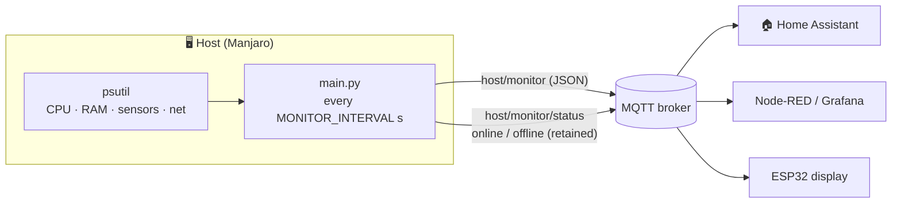

<div align="center">

# 📡 mqtt-monitor

**Lightweight host monitor that publishes system stats as JSON via MQTT.**

CPU load · temperatures · RAM usage · network throughput · online/offline status


</div>

---

## 📑 Contents

- [Overview](#-overview)
- [Features](#-features)
- [How it works](#-how-it-works)
- [Requirements](#-requirements)
- [Installation](#-installation)
- [Configuration](#%EF%B8%8F-configuration)
- [MQTT topics and payload](#-mqtt-topics-and-payload)
- [Running as a systemd user service](#%EF%B8%8F-running-as-a-systemd-user-service)
- [Home Assistant integration](#-home-assistant-integration)
- [Testing and debugging](#-testing-and-debugging)
- [Troubleshooting](#-troubleshooting)
- [Project structure](#-project-structure)
- [Design notes](#-design-notes)

---

## 🔭 Overview

`mqtt-monitor` is a small Python script that reads the current state of the
machine it runs on and publishes it as a compact JSON document to an MQTT broker
at a fixed interval. Any MQTT consumer can pick up the data: Home Assistant,
Node-RED, Grafana (via Telegraf), an ESP32 display or a simple `mosquitto_sub`.

It is built for an always-on, unattended setup: it survives broker outages,
announces its own availability and shuts down cleanly when systemd stops it.

## ✨ Features

| | Feature | Details |
|---|---|---|
| 🧮 | **CPU load per core** | Load of the first four cores in percent |
| 🌡️ | **Temperatures** | CPU (`coretemp`) and NVMe SSD (`nvme`) in °C |
| 🧠 | **RAM usage** | Used memory in percent |
| 🌐 | **Network throughput** | Download and upload in KiB/s, averaged over the interval |
| 🟢 | **Availability** | Retained `online`/`offline` status, also set as Last Will |
| 🔁 | **Auto-reconnect** | Keeps retrying with backoff (1 s up to 60 s) if the broker is down |
| 🛑 | **Clean shutdown** | Handles `SIGINT` and `SIGTERM`, publishes `offline` before exiting |
| ⚙️ | **Configurable** | Broker, credentials, topic and interval via a git-ignored `secrets.env` |

## 🧩 How it works



1. On start, the script connects to the broker in the background and registers a
   **Last Will** (`offline` on the status topic).
2. Once connected, it publishes a retained `online` to the status topic.
3. In each interval it collects all values through `psutil` and publishes them as
   one JSON object. Network rates are calculated from the byte counters and the
   time that actually passed since the previous measurement.
4. While the broker is unreachable, measurements continue but are not sent. The
   client reconnects on its own.
5. On `Ctrl+C` or `systemctl stop`, it publishes `offline`, disconnects cleanly
   and exits.

## 📋 Requirements

- **Linux.** Temperatures are read via `psutil.sensors_temperatures()`, which
  only works on Linux. The script expects the sensors `coretemp` (Intel CPU) and
  `nvme` (NVMe SSD). Missing sensors are reported as `null`.
- **Python 3.14**
- **[uv](https://docs.astral.sh/uv/)** for dependency management
- A reachable **MQTT broker**, e.g. Mosquitto

Install uv on Manjaro/Arch:

```shell
sudo pacman -S uv
```

Python dependencies (installed automatically by `uv sync`):

| Package | Purpose |
|---|---|
| [`paho-mqtt`](https://pypi.org/project/paho-mqtt/) ≥ 2.1 | MQTT client |
| [`psutil`](https://pypi.org/project/psutil/) ≥ 7.2 | System metrics |

## 🚀 Installation

```shell
git clone git@github.com:ro011110ot/mqtt-monitor.git ~/_scripts/mqtt_monitor
cd ~/_scripts/mqtt_monitor
uv sync
cp secrets.example.env secrets.env
chmod 600 secrets.env
micro secrets.env   # set at least MQTT_BROKER
```

Start it in the foreground:

```shell
uv run python main.py
```

Expected output:

```text
Monitoring started on Manjaro...
Connected to mqtt.example.com:1883
```

Stop it with `Ctrl+C`; it prints `Stopping...` and exits cleanly.

## ⚙️ Configuration

Settings live in **`secrets.env`** next to `main.py`. The file holds private
values such as the broker address and credentials, so it is listed in
`.gitignore` and never committed. The template
[`secrets.example.env`](secrets.example.env) lists every available entry:

```shell
# Required: hostname or IP address of the MQTT broker
MQTT_BROKER=mqtt.example.com

# Optional (defaults shown)
MQTT_PORT=1883
MQTT_CLIENT_ID=Manjaro
MQTT_TOPIC=host/monitor
MONITOR_INTERVAL=5

# Optional: broker credentials (leave empty for anonymous access)
MQTT_USERNAME=
MQTT_PASSWORD=
```

| Variable           | Default        | Description                                      |
|--------------------|----------------|--------------------------------------------------|
| `MQTT_BROKER`      | – (required)   | Hostname or IP address of the broker             |
| `MQTT_PORT`        | `1883`         | Broker port (plain MQTT, no TLS)                 |
| `MQTT_CLIENT_ID`   | `Manjaro`      | MQTT client ID, also shown in the start log      |
| `MQTT_TOPIC`       | `host/monitor` | Data topic; the status topic is `<topic>/status` |
| `MONITOR_INTERVAL` | `5`            | Seconds between two measurements (float allowed) |
| `MQTT_USERNAME`    | – (anonymous)  | Username for broker authentication               |
| `MQTT_PASSWORD`    | –              | Password for broker authentication               |

How values are resolved:

1. Environment variables that are already set win.
2. Otherwise the value from `secrets.env` is used.
3. Otherwise the default from the table applies.

If `MQTT_BROKER` is missing, the script exits right away with a hint to create
`secrets.env`.

A one-off override from the shell, e.g. a 10-second interval:

```shell
MONITOR_INTERVAL=10 uv run python main.py
```

> [!CAUTION]
> Never commit `secrets.env`. Check with `git check-ignore -v secrets.env`;
> it must print the matching `.gitignore` rule.

> [!TIP]
> If you monitor several hosts, give each one its own `MQTT_CLIENT_ID` and
> `MQTT_TOPIC` (e.g. `host/laptop`, `host/nuc`). Two clients with the same ID
> keep kicking each other off the broker.

## 📨 MQTT topics and payload

### Data topic: `host/monitor`

Published every `MONITOR_INTERVAL` seconds (not retained, QoS 0):

```json
{
  "cpu": [17.7, 20.0, 15.2, 30.7],
  "cpu_temp": 66.0,
  "ram": 38.8,
  "ssd_temp": 25.9,
  "gpu_temp": 66.0,
  "gpu_mem": 0,
  "net_down": 2.3,
  "net_up": 1.8
}
```

| Field      | Type            | Unit  | Description                                                   |
|------------|-----------------|-------|---------------------------------------------------------------|
| `cpu`      | array of float  | %     | Load of the first 4 CPU cores                                 |
| `cpu_temp` | float or `null` | °C    | CPU package temperature (`coretemp`)                          |
| `ram`      | float           | %     | Used memory                                                   |
| `ssd_temp` | float or `null` | °C    | NVMe SSD temperature (`nvme`)                                 |
| `gpu_temp` | float or `null` | °C    | Same as `cpu_temp`; the Intel UHD iGPU sits on the CPU die    |
| `gpu_mem`  | int             | –     | Always `0`; the iGPU uses shared system memory                |
| `net_down` | float           | KiB/s | Received bytes across all interfaces, averaged over the interval |
| `net_up`   | float           | KiB/s | Sent bytes across all interfaces, averaged over the interval  |

All floats are rounded to one decimal place.

### Status topic: `host/monitor/status`

| Payload   | When                                                                |
|-----------|---------------------------------------------------------------------|
| `online`  | Right after every successful (re)connect                            |
| `offline` | On clean shutdown, or sent by the broker as Last Will after a crash or network loss |

The status message is **retained**, so a consumer that subscribes later sees the
current state immediately.

## 🛠️ Running as a systemd user service

The included unit [`mqtt-monitor.service`](mqtt-monitor.service) runs the
script as a **user service**, so no root access is needed.

```shell
mkdir -p ~/.config/systemd/user
ln -s ~/_scripts/mqtt_monitor/mqtt-monitor.service ~/.config/systemd/user/
systemctl --user daemon-reload
systemctl --user enable --now mqtt-monitor.service
```

Useful commands:

```shell
systemctl --user status mqtt-monitor.service    # current state
journalctl --user -u mqtt-monitor.service -f    # follow the log
systemctl --user restart mqtt-monitor.service   # restart after changes
```

What the unit does:

- runs `uv run --frozen python main.py` from the project directory
- sets `PYTHONUNBUFFERED=1` so log lines appear in the journal immediately
- restarts the script after 10 seconds if it exits with an error

The service reads its settings from `secrets.env` like a manual run does, so
there is nothing to configure in the unit itself.

> [!IMPORTANT]
> `--frozen` makes uv use `uv.lock` exactly as committed. After changing
> dependencies, run `uv lock` (or `uv sync`) and commit the updated `uv.lock`,
> otherwise the service will not start.

### Changing settings for the service

Edit `secrets.env` and restart the service. Alternatively, a drop-in override
sets values for the service only; they take precedence over `secrets.env`:

```shell
systemctl --user edit mqtt-monitor.service
```

```ini
[Service]
Environment=MONITOR_INTERVAL=10
Environment=MQTT_TOPIC=host/laptop
```

### Starting without login (optional)

User services normally run only while you are logged in. To start the monitor
at boot:

```shell
sudo loginctl enable-linger "$USER"
```

## 🏠 Home Assistant integration

Add MQTT sensors to `configuration.yaml` (or a package file). All sensors share
the status topic as availability, so they turn *unavailable* when the host goes
offline.

```yaml
mqtt:
  sensor:
    - name: "Manjaro CPU temperature"
      unique_id: manjaro_cpu_temp
      state_topic: "host/monitor"
      value_template: "{{ value_json.cpu_temp }}"
      unit_of_measurement: "°C"
      device_class: temperature
      state_class: measurement
      availability_topic: "host/monitor/status"

    - name: "Manjaro SSD temperature"
      unique_id: manjaro_ssd_temp
      state_topic: "host/monitor"
      value_template: "{{ value_json.ssd_temp }}"
      unit_of_measurement: "°C"
      device_class: temperature
      state_class: measurement
      availability_topic: "host/monitor/status"

    - name: "Manjaro RAM usage"
      unique_id: manjaro_ram
      state_topic: "host/monitor"
      value_template: "{{ value_json.ram }}"
      unit_of_measurement: "%"
      state_class: measurement
      availability_topic: "host/monitor/status"

    - name: "Manjaro CPU core 0"
      unique_id: manjaro_cpu0
      state_topic: "host/monitor"
      value_template: "{{ value_json.cpu[0] }}"
      unit_of_measurement: "%"
      state_class: measurement
      availability_topic: "host/monitor/status"

    - name: "Manjaro download"
      unique_id: manjaro_net_down
      state_topic: "host/monitor"
      value_template: "{{ value_json.net_down }}"
      unit_of_measurement: "KiB/s"
      device_class: data_rate
      state_class: measurement
      availability_topic: "host/monitor/status"

    - name: "Manjaro upload"
      unique_id: manjaro_net_up
      state_topic: "host/monitor"
      value_template: "{{ value_json.net_up }}"
      unit_of_measurement: "KiB/s"
      device_class: data_rate
      state_class: measurement
      availability_topic: "host/monitor/status"
```

The default availability payloads in Home Assistant are `online` and
`offline`, which match this script, so no extra settings are needed.

## 🧪 Testing and debugging

Watch all messages with the Mosquitto client (`sudo pacman -S mosquitto`):

```shell
mosquitto_sub -h mqtt.example.com -t 'host/monitor/#' -v
```

Pretty-print only the payload with `jq`:

```shell
mosquitto_sub -h mqtt.example.com -t 'host/monitor' | jq .
```

Check which temperature sensors `psutil` sees on your machine:

```shell
uv run python -c "import psutil; print(list(psutil.sensors_temperatures()))"
```

## 🩺 Troubleshooting

| Symptom | Cause and fix |
|---|---|
| `MQTT_BROKER is not set` | `secrets.env` is missing or has no `MQTT_BROKER` entry. Create it from `secrets.example.env`. |
| `cpu_temp` / `ssd_temp` is `null` | The sensor is missing or has another name. Run the sensor check above. AMD CPUs report `k10temp` instead of `coretemp`. |
| `Connection failed: ...` | The broker rejected the connection, e.g. wrong or missing `MQTT_USERNAME` / `MQTT_PASSWORD`, or the client ID is not allowed. |
| Constant `Disconnected` / `Connected` loop | Another client uses the same `MQTT_CLIENT_ID` (e.g. a second instance of this script). Stop it or change the ID. |
| `Disconnected (...), reconnecting...` | The broker or network is gone. The script keeps retrying with up to 60 seconds between attempts. Nothing to do. |
| No messages, no `Connected` log line | The broker is not reachable. Check hostname, port and the network (e.g. Tailscale). |
| Service fails right after start | Usually `uv.lock` is out of date (see `--frozen` above), or `uv` is not at `/usr/bin/uv` (check with `which uv`). |
| Status stays `offline` after a crash | Expected. It switches back to `online` on the next successful connect. |

## 📁 Project structure

```text
mqtt_monitor/
├── main.py                # The monitor
├── mqtt-monitor.service   # systemd user unit
├── secrets.example.env    # Template for the configuration
├── secrets.env            # Your configuration (git-ignored, create it yourself)
├── pyproject.toml         # Project metadata and dependencies
├── uv.lock                # Locked dependency versions
├── .python-version        # Python version for uv (3.14)
└── README.md
```

## 🧠 Design notes

- **Non-blocking connect.** `connect_async()` and `loop_start()` let the
  monitor start even if the broker is down at boot. Without that, a single
  failed connect would stop the script.
- **Accurate rates.** Network throughput is divided by the measured time
  (`time.monotonic()`) instead of the configured interval, so slow iterations
  or skipped publishes do not distort the values.
- **Primed counters.** CPU and network counters are read once before the loop,
  so even the first message covers a full interval rather than showing `0.0`.
- **Explicit `offline`.** A clean `disconnect()` suppresses the Last Will, so the
  script publishes `offline` itself before disconnecting.
- **No hard-coded private data.** The broker address and credentials only live
  in the git-ignored `secrets.env`. The file is parsed by a tiny built-in loader,
  so no extra dependency such as `python-dotenv` is needed.
- **Fault tolerance.** An error during one measurement is logged and does not
  stop the loop.
